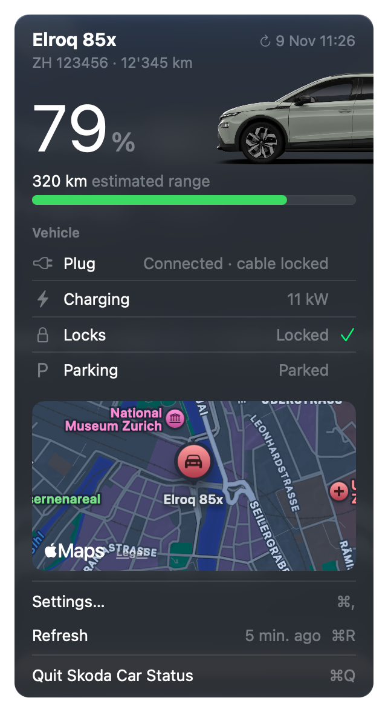

# Car Status for Škoda

A macOS menu bar app that shows the status of your Škoda at a glance. It reads the data from the [MyŠkoda Public API](https://public.api.connect.skoda-auto.cz/docs).

<p align="center">
  
</p>

## Features

- Battery level, range and charging state (including charge power and plug status)
- Lock state, odometer, vehicle name and licence plate
- Parking position on a map
- Background polling, plus a refresh when the popover opens, on manual refresh and after the Mac wakes from sleep
- Credentials stored in the macOS Keychain

## Requirements

- macOS 26.0 or later
- Xcode with Swift 6
- A MyŠkoda Public API key and the VIN of your vehicle

## Build

```sh
open SkodaCarStatus.xcodeproj
```

Then run the `SkodaCarStatus` scheme from Xcode. The app has no Dock icon; it lives in the menu bar.

## Download

Grab the latest `SkodaCarStatus-<version>.zip` from [Releases](https://github.com/gempi/skoda-car-status/releases). The app is not notarized, so on first launch right-click it and choose **Open** (or run `xattr -dr com.apple.quarantine SkodaCarStatus.app`).

## Releases

Commits to `main` use [Conventional Commits](https://www.conventionalcommits.org) (`feat:`, `fix:`, `feat!:`). [release-please](https://github.com/googleapis/release-please) keeps a release PR up to date; merging it tags the version, creates the GitHub release and attaches the built app.

## Setup

1. Click the menu bar icon and open **Settings**.
2. Enter your API key and the 17-character VIN.

## Disclaimer

Unofficial app. Not affiliated with, endorsed by or sponsored by ŠKODA AUTO a.s. Škoda is a registered trademark of ŠKODA AUTO a.s.
